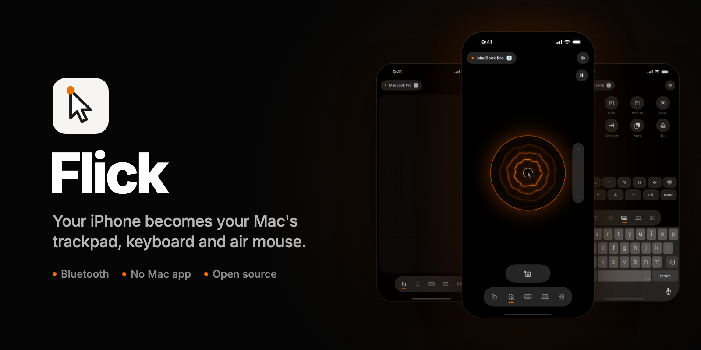
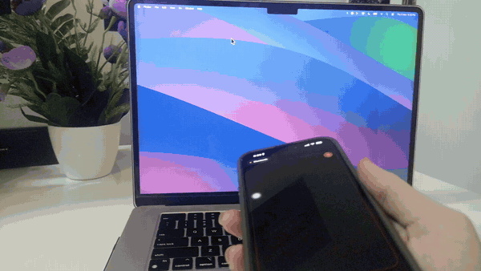
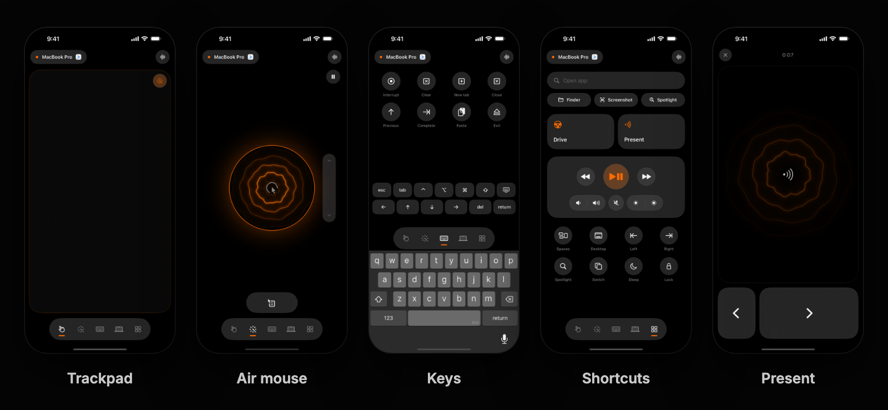
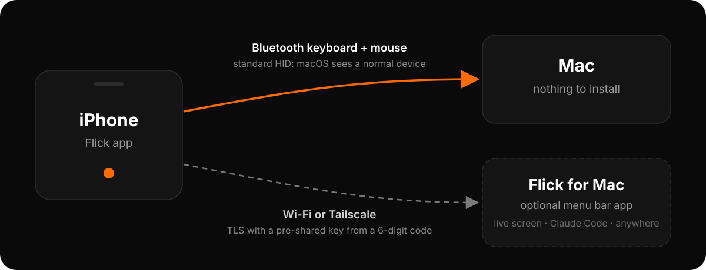

<p align="center">
  
</p>

<p align="center">
  <b>Your iPhone becomes your Mac's trackpad, keyboard and air mouse.</b><br>
  Nothing to install on the Mac: it connects over Bluetooth like any keyboard and mouse.
</p>

<p align="center">
  
  
  
  
</p>

<p align="center">
  
</p>

## What it does

<p align="center">
  
</p>

| Mode | |
|---|---|
| **Trackpad** | One finger moves, tap clicks, two-finger tap right-clicks, two-finger scroll with momentum, press and hold to drag, pinch to zoom, three-finger swipes for Mission Control and Spaces. Move the phone itself to nudge the cursor too. |
| **Air mouse** | Open it and point: the cursor follows the phone. Tap the orb to click, hold it to drag, pause pointing with the small button. |
| **Keys** | The iOS keyboard types on the Mac. Sticky ⌘ ⌥ ⌃ ⇧, esc, tab and arrows, plus a grid of shortcuts for the app in front. |
| **Shortcuts** | Open any app, Finder, Screenshot, Spotlight, media and volume, brightness, Spaces, app switcher, sleep and lock. |
| **Drive** | Tilt the phone to steer, with pedals for gas and brake. |
| **Present** | Point to aim, tap to go through your slides. |
| **Screen** · *Flick for Mac* | A live view of the Mac's screen. Tap anywhere on it to click there. |
| **Ask** · *Flick for Mac* | Say what you want; Claude Code does it on the Mac and the answer is read back. |

Siri, Shortcuts and the Action Button get four actions: **Ask your Mac**, **Play or pause on Mac**, **Lock Mac** and **Sleep Mac display**.

## How it works

<p align="center">
  
</p>

Flick turns the iPhone into a standard **Bluetooth LE keyboard and mouse** (HID over GATT). macOS sees an ordinary input device, so there is no driver, no helper app and no setting to change: open Flick, tap your Mac, done.

A Mac signed in to the same Apple Account as the iPhone never lists it under Bluetooth settings, so Flick connects from the phone side and the Mac picks it up as a keyboard and mouse. Other hosts that accept Bluetooth LE keyboards can pair from their own Bluetooth settings, where it appears as **Flick** (only macOS is tested). It reconnects by itself whenever Flick is open.

**Flick for Mac** is an optional menu bar app for the things Bluetooth can't do:

| | Bluetooth only | With Flick for Mac |
|---|:---:|:---:|
| Cursor, clicks, drag, scroll, typing, media keys | ✓ | ✓ |
| Typing any character and any keyboard layout | US layout | ✓ |
| Horizontal scrolling | | ✓ |
| Live screen view, tap to click | | ✓ |
| Absolute pointing and an on-screen laser dot | | ✓ |
| Shortcuts that follow the app in front | | ✓ |
| Ask Claude Code by voice | | ✓ |
| Use from anywhere (Tailscale) | | ✓ |

When both are connected, Flick sends everything through the Mac app.

## Get started

**You need** an iPhone on iOS 18 or later, a Mac on macOS 14 or later, Xcode 26 or later and [XcodeGen](https://github.com/yonaskolb/XcodeGen) (`brew install xcodegen`).

1. Clone the repo and create `Config/Local.xcconfig` with your signing details (the file is git-ignored):

   ```
   DEVELOPMENT_TEAM = <your Apple developer team ID>
   FLICK_BUNDLE_PREFIX = <a reverse-DNS prefix you own>
   ```

   Your team ID is in Xcode → Settings → Accounts. Bundle IDs become `<prefix>.flick` and `<prefix>.flick.mac`.

2. Generate the project, then run the **Flick** scheme on your iPhone:

   ```sh
   xcodegen generate
   open Flick.xcodeproj
   ```

3. Open Flick on the phone and tap your Mac.

### Flick for Mac (optional)

```sh
Tools/build-mac.sh --install     # builds Flick.app into /Applications and opens it
```

Allow **Accessibility** (to move the cursor and type) and, for the screen view, **Screen Recording**. Then choose **Pair iPhone** in the menu bar and type the 6-digit code in Flick → Settings → Pair Flick for Mac. Ask needs the [Claude Code](https://docs.anthropic.com/en/docs/claude-code) CLI on the Mac.

From the menu bar you can keep the Mac awake, open Flick at login, forget paired phones, and choose whether Claude may run shell commands (off by default: Claude can read and edit files, but not run commands).

## Security

- **Pairing:** TLS 1.2 with a pre-shared key derived from a 6-digit code shown on the Mac. The code is only valid while the pairing window is open.
- **After pairing:** every connection is TLS-PSK with a random 256-bit secret, kept in the iPhone's Keychain and in a `0600` file in `~/Library/Application Support/Flick` on the Mac.
- **Leaving:** when a phone disconnects, every key and button it was holding is released.

## Project layout

```
iOS/                 the iPhone app (SwiftUI): modes, motion, Bluetooth HID, connection to the Mac app
iOS/Design/          glass surfaces, dock, Metal shaders
FlickKit/            shared Swift package: protocol, framing, TLS-PSK, HID reports, air-mouse math
Mac/Core/            Flick for Mac engine: server, input injection, screen streaming, Claude runner
Mac/App/             Flick for Mac menu bar app
Vendor/BTHIDKit/     Bluetooth LE HID peripheral (vendored, AGPL-3.0)
iOSUITests/          UI tests for the iPhone app
Tools/               build and test scripts, flickctl, probes
Config/              signing and bundle ID settings
```

## Testing

| Command | What it covers | Touches your Mac? |
|---|---|:---:|
| `Tools/test.sh` | 29 unit tests: framing, air-mouse math, steering, key codes, HID reports replayed into a fake host (typing with symbols, motion merged without losing distance, click vs drag, held keys, scroll) and a real TLS-PSK handshake. | No |
| `Tools/sim-e2e.sh` | The iPhone app on the simulator against Flick for Mac in dry-run mode, which records every command instead of acting on it. Pairing with right and wrong codes, trackpad, typing, air mouse, modes, Ask and the one-shot shortcut connection, then checks what arrived. | No |
| `Tools/e2e.sh` | The same UI tests on a real iPhone against Flick for Mac in test mode, checked on the Mac side. | Moves the cursor and types |
| `Tools/bt-e2e.sh` | Bluetooth-only mode on a real iPhone that is already connected to the Mac. | Moves the cursor and types |
| `flickctl selftest` | A fake iPhone against a running Flick for Mac: cursor, typing, clicks, scroll, held keys, media, screen stream and release on disconnect (`--ask` adds Claude). | Moves the cursor and types |

The tests that touch the Mac skip or wait while someone is using it (input in the last 15 seconds); `FLICK_FORCE=1` or `--force` overrides that. `Tools/probes/` has two listen-only tools for checking what macOS receives: `hidlisten` prints raw Bluetooth HID reports and `clicktap` logs every click and how long it was held.

Flick for Mac reads these environment variables in test runs:

| Variable | Effect |
|---|---|
| `FLICK_DRY_RUN=<file>` | Record every command to the file and never act on the Mac |
| `FLICK_PAIR_CODE=<code>` | Open pairing at launch with a fixed code |
| `FLICK_DATA_DIR=<dir>` | Keep identity and pairings in another folder |
| `FLICK_NAME=<name>` | Advertise a different Mac name |
| `FLICK_HEADLESS=1` | No menu bar item |
| `FLICK_NO_PROMPT=1` | Don't ask for Accessibility at launch |
| `FLICK_PROBE=<file>` | Open a test window that records the keys, clicks and scrolling it receives |
| `FLICK_LOG=1` | Log received commands to stdout |

## Credits and license

The Bluetooth LE HID stack in `Vendor/BTHIDKit` and its report layout come from [jqssun/darwin-bt-remote](https://github.com/jqssun/darwin-bt-remote) (AGPL-3.0). Flick's changes there are marked `Flick:` in the source: a send queue so reports are never dropped while the radio is busy, and hooks for pacing.

Flick is licensed under the [GNU AGPL-3.0](LICENSE). If you distribute a build or run a modified version as a service, its source must be available under the same license.
